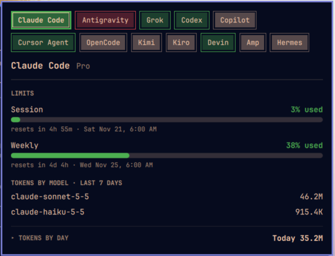

# Agent Usage Tabs

> **Goal:** a dashboard for developers in flow state. One glance at the bar
> shows every agent's limits, and one click fixes a wall without leaving their
> work. Design calls favor what keeps the developer in flow: glanceable,
> quiet, self-maintaining, and honest about missing data.

An Omarchy bar plugin that shows AI coding agent usage in one panel: a tab per
installed agent, limit meters with reset countdowns, tokens by model, and a
collapsible daily history.



- **Bar icon with a number**, like the battery: the highest *session* usage
  across all agents (amber from 60%, red above 85%).
- **Tabs** for every installed agent, in an order you control. Each chip shows
  two meters at a glance: the **outer border is the session meter** and the
  **inner fill is the weekly meter** (green under 60%, amber 60–85%, red above
  85%). An agent with one meter uses it for both; agents with only monthly or
  daily meters use the fullest of those; gray means no data. The selected tab
  has a thicker border, an inner ring and bold text. A chip flashes solid green
  for 10 seconds after a reset.
- **Models section** on every tab: every model the agent can use. Models in use come first; unused ones are dimmed with a 0; models the plan can't use say *unavailable* (never 0); announced removals carry an amber *removing Dec 14* badge. Long lists (Devin, OpenCode) show 8 rows with a *N more models* toggle.
- **Per tab:** session / weekly / monthly meters with countdowns, tokens by
  model, and a "Tokens by day" section that starts closed. Today's total
  stays visible in its header. No data shows a one-line status, not an error.
- **Reset time on every meter:** the countdown plus the local date and time
  (`resets in 3d 2h · Tue Nov 24, 3:12 AM`) whenever the agent reports one.
- **Resets line** (Claude and Codex): banked limit resets and when they
  expire, shown only when the account has them.
- **Notifications** when any agent's session or weekly limit passes 95%
  (once per window), and a **reset celebration**: when a session or weekly
  meter drops by more than 50 points between refreshes, that agent's tab
  chip flashes green for 10 seconds and a quiet notification names the agent.
  Notifications are sent with sound suppressed.

Supported agents: Claude Code, Antigravity, Grok, Codex, Copilot, Cursor Agent,
OpenCode, Kimi, Kiro, Devin, Amp, Hermes. A tab appears only if the CLI is
installed. Kiro and Amp have no usage source yet, so their tabs show a status
line.

## Requirements

- Omarchy with shell plugins (`omarchy plugin` works)
- `node` 18 or newer (it uses built-in `fetch`)
- `notify-send` (for alerts)
- `secret-tool` (libsecret), only for Antigravity if its login is in the keyring
- Omarchy's own `omarchy-agent-usage-*` collectors, used for the agents that
  have no collector of their own here (Codex, Copilot, Cursor, OpenCode, Kimi,
  Devin, Hermes)

## Install

This plugin is installed from a local folder. Nothing is published anywhere.

1. Put the folder at `~/.config/omarchy/plugins/spaceman.agent-usage-tabs/`
   (it contains `manifest.json`, `Panel.qml`, `bin/`).
2. Confirm Omarchy sees it:
   ```
   omarchy plugin list | grep usage-tabs
   ```
3. Enable it:
   ```
   omarchy plugin enable spaceman.agent-usage-tabs
   ```
4. Restart the shell so it compiles the QML (hot reload is not reliable):
   ```
   omarchy-restart-shell
   ```
5. Click the robot icon in the bar. Middle-click cycles tabs. In the panel:
   Left/Right switch tabs, Space toggles the daily section, `r` refreshes,
   Esc closes.

## Settings

Set these in the plugin's entry in `~/.config/omarchy/shell.json`:

```json
{
  "id": "spaceman.agent-usage-tabs",
  "tabOrder": "claude,antigravity,grok,codex",
  "refreshIntervalSec": 300,
  "notifyThreshold": 95,
  "showUnusedModels": true
}
```

| Setting | Default | Meaning |
|---|---|---|
| `tabOrder` | all 12, as listed above | Comma-separated agent ids, in tab order. Ids you leave out are appended in default order, so no tab is ever hidden. Unknown ids are ignored. |
| `refreshIntervalSec` | 300 | How often the collector runs. Minimum 60. |
| `notifyThreshold` | 95 | Notify when a session or weekly limit passes this percent. |
| `showUnusedModels` | true | Show every model an agent can use, dimmed when unused or marked unavailable. `false` lists only models with recent use. The older key `showAllClaudeModels` still works. |

Agent ids: `claude`, `antigravity`, `grok`, `codex`, `copilot`, `cursor`,
`opencode`, `kimi`, `kiro`, `devin`, `amp`, `hermes`.

Back up `shell.json` before editing it. After changing a setting, restart the
shell.

## Where the data comes from

`bin/collect.mjs` writes one file,
`~/.local/state/omarchy/agent-usage-tabs/data.json`, and the panel only reads
it.

| Agent | Source |
|---|---|
| Claude Code | `https://api.anthropic.com/api/oauth/usage` using the OAuth login in `~/.claude/.credentials.json`, plus tokens from `~/.claude/projects` transcripts (last 7 days). Limits are cached 5 minutes because the endpoint rate-limits (HTTP 429). A **Fable Weekly** bar is added only when the payload's `limits` array carries a model-scoped entry for Fable (`scope.model.display_name` or `id` containing "fable"); Max and Ultra plans are reported to have a separate Fable weekly limit, but a Pro account's payload has no such entry, so nothing is shown and nothing is guessed. `bin/claude-limits.test.mjs` covers the parser (`node bin/claude-limits.test.mjs`). |
| Grok | `bin/grok.mjs`, from the Grok CLI login in `~/.grok/auth.json`, against the same billing endpoints Grok's own `/usage` uses. |
| Antigravity | `bin/agy.mjs`, from the local agy login (Secret Service entry `service=gemini username=antigravity`, or `~/.gemini/antigravity-cli/antigravity-oauth-token`), against Google's `retrieveUserQuotaSummary`. Google may report no Gemini group on some plans; the tab says so. |
| Copilot | `bin/copilot.mjs`: GitHub's quota endpoint with the token `gh auth token` prints. A meter appears only with a limited allowance; an account with no included allowance gets one status line with the monthly reset date. |
| Others | Omarchy's `omarchy-agent-usage-<agent>` records, refreshed by `omarchy-agent-usage-update`. |

**Credentials are read-only.** The collectors never refresh or write a token.
If one has lapsed, the tab says to start that CLI once. Tokens are sent only to
the vendor's own endpoint listed above.

## Models and `models.json`

Each tab's Models list is built live-data-first:

1. models the agent reported using (last 7 days for Claude, all time for the others),
2. models the agent's own CLI says it can use, refreshed every 6 hours
   (`agy models`, `grok models`, `opencode models`, `devin models`,
   `kiro-cli chat --list-models`, `codex debug models`), run headless,
3. the entries in **`models.json`**, which you can edit by hand.

If a CLI lists its models, any `models.json` entry missing from that list is
shown as *unavailable*. Without a CLI list (Cursor, Copilot, Kimi, Amp,
Hermes, Claude), an entry is unavailable only if you list the plan in its
`unavailableOn`. Put `"removing": "2026-12-14"` (or `"2026-12"`) on a model with
an announced removal. A past date shows *past removal date*, which is how a
model looks when it is still listed after its announced removal. A model that
is truly gone should be deleted (note it under `removed`). Edits apply on the
next refresh; a malformed file is ignored and live data still shows.

## Banked resets

- **Claude:** Claude Code reads them from the `cedar_ember` block of the same
  `/api/oauth/usage` response (grants with `resets_left`, `ends_at`, `paused`,
  `usable_now`). The Resets line sums unpaused grants and shows the earliest
  expiry. A Pro account's payload has `cedar_ember: null`, so no line shows.
- **Codex:** the Codex login exposes `rateLimitResetCredits`; Omarchy's Codex
  collector turns it into `resetCredits {available, nextExpiresAt}`. Each
  reset refreshes both the 5-hour and weekly windows and moves the weekly
  reset date. A free account has none, so no line shows.
- Neither could be checked against a live account that holds resets; the
  parsers are tested with payloads shaped like Claude Code's and Omarchy's own
  code reads them.

## Antigravity and Grok sign-in

agy keeps its own token for an hour and refreshes it itself. The collector
never refreshes or writes it. When the token has lapsed or expires within
2 minutes, the collector runs `agy models` once in the background (no display
variables, so it can never open a browser window), then reads the login again.
It does this at most once every 10 minutes. If agy cannot refresh it, the tab
says to run `agy` and sign in again. Grok works the same way with
`grok models` (its token lasts six hours).

## Notifications

Any limit whose title contains "session" or "weekly", for every agent that
reports one, fires a single critical notification when it passes the
threshold. State is kept in `notified.json` beside `data.json`. A window alerts once. It is forgotten only when its meter is reported back at or below the threshold; a refresh where an agent errors or the meter is missing changes nothing, so an outage cannot cause a repeat alert.

## Tests

```
for t in bin/*.test.mjs; do node "$t"; done
```

## Troubleshooting

- **Icon missing from the bar:** it hides when no agent data has loaded. Run
  `node ~/.config/omarchy/plugins/spaceman.agent-usage-tabs/bin/collect.mjs`
  and check for errors.
- **Changes not showing:** run `omarchy-restart-shell`.
- **QML errors:** `qs log -i <instance>` and look for `usage-tabs`.
- **Claude shows "Rate limited":** it is showing the last known limits; wait a
  few minutes.

## Uninstall

```
omarchy plugin disable spaceman.agent-usage-tabs
omarchy plugin remove spaceman.agent-usage-tabs --yes
rm -r ~/.local/state/omarchy/agent-usage-tabs
```

## License

MIT
