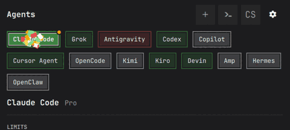
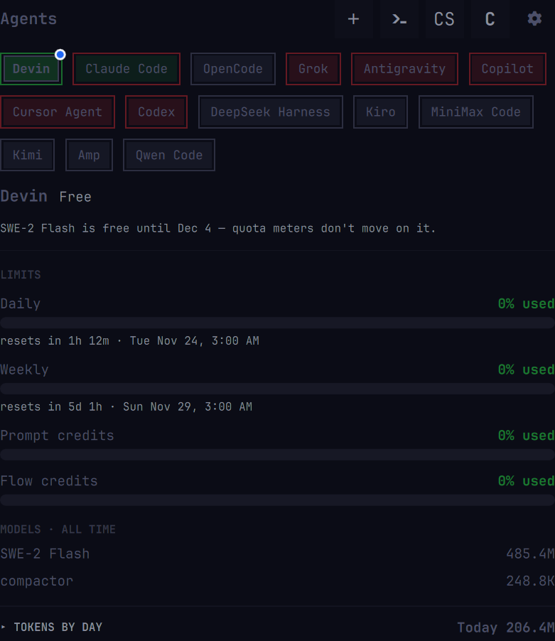
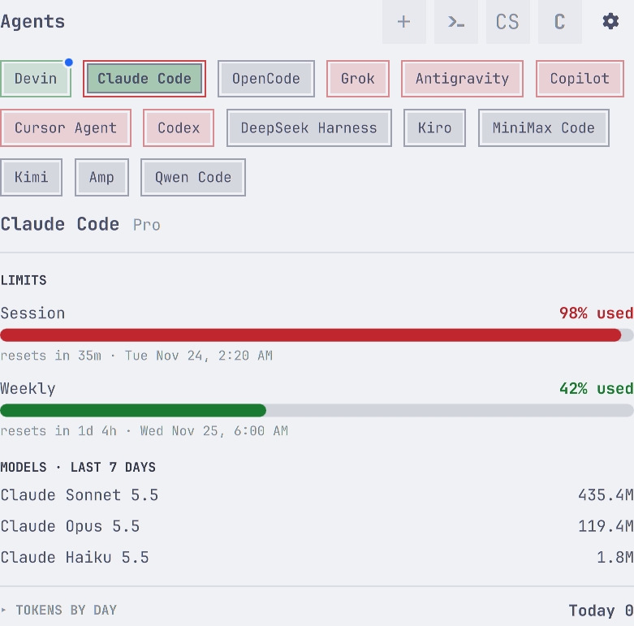
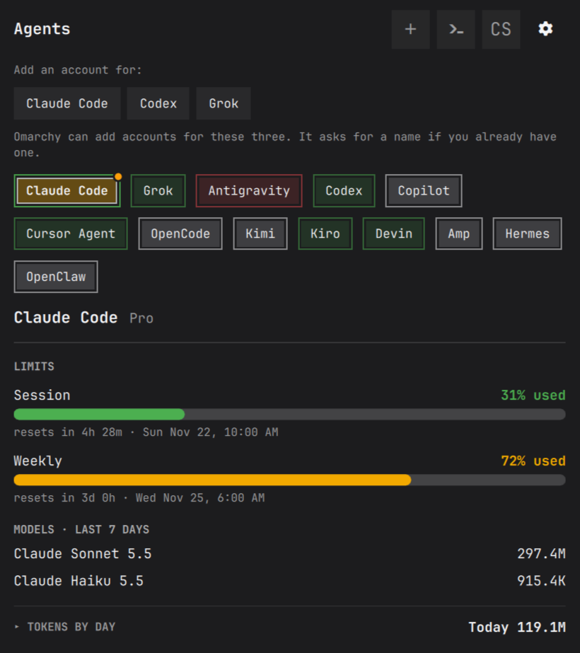
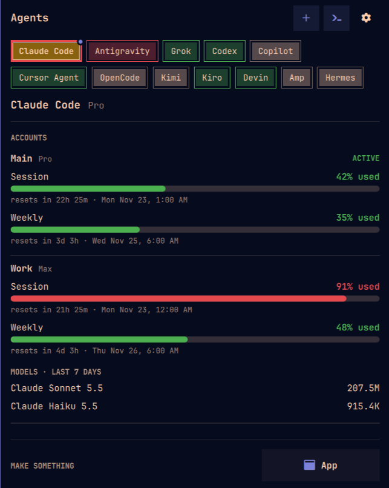
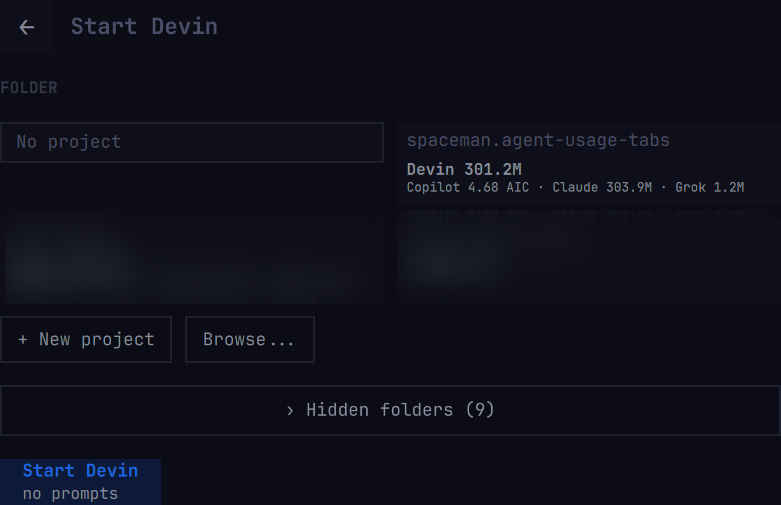
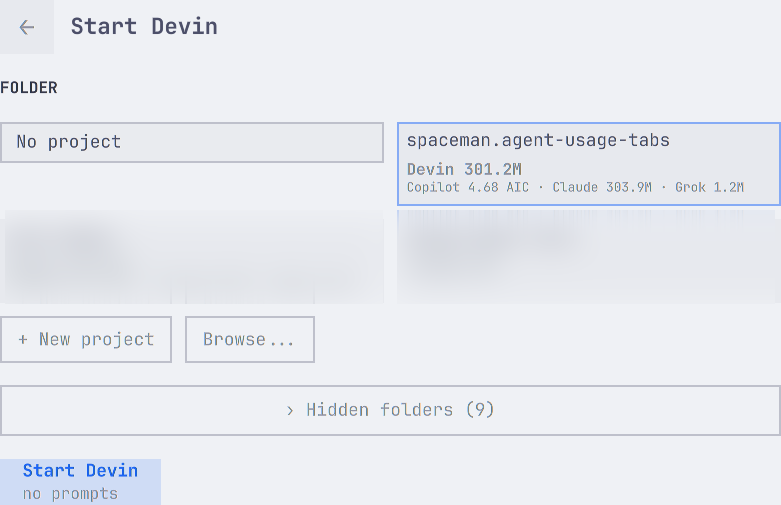
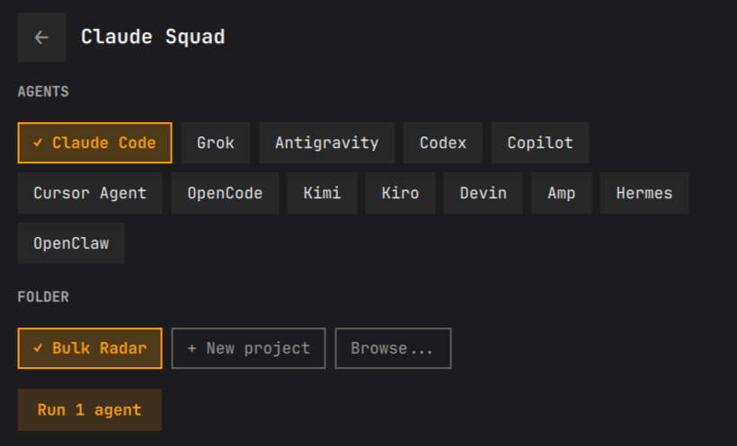
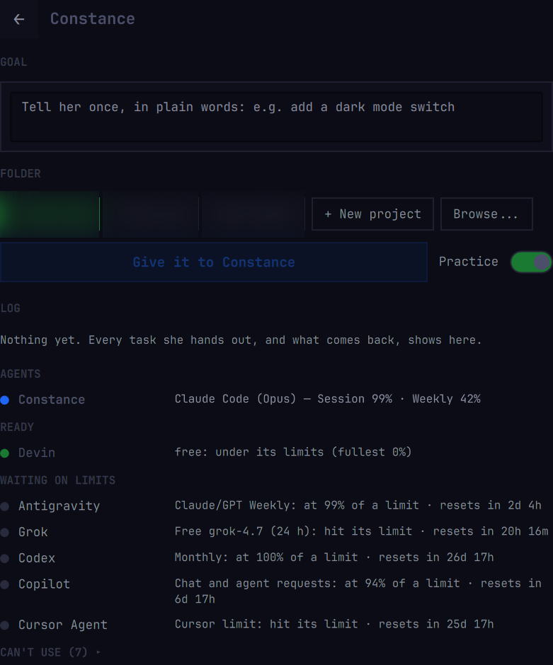
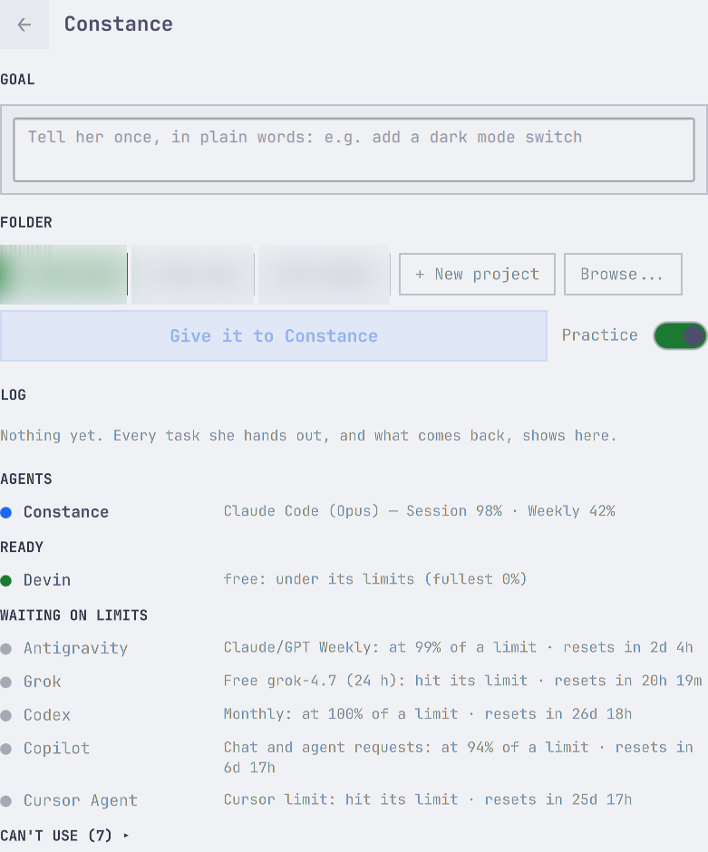

# Cook Meter

**Know exactly when you can go cook.** (Plugin id and repo: `spaceman.agent-usage-tabs`.)

> **The idea:** a dashboard for developers in flow state. One glance at the bar shows every
> agent's limits, and a celebration fires the moment a reset lands.

## See it



*A scheduled reset: Claude Code's session meter reset on time, so its chip flashes green with a burst of confetti.*


*A surprise reset: an Antigravity meter dropped before its reset time, so the chip flashes gold with two shockwave rings and a burst of rainbow confetti.*

GIFs have no sound. The real thing plays a short cha-ching for a normal reset (and a jackpot for a surprise).

Cook Meter is an [Omarchy](https://omarchy.org) bar plugin (its plugin id and repo are still
`spaceman-agent-usage-tabs`, so existing installs and links keep working) that shows how much of your AI coding
agents' usage limits you have used: one bar icon, one panel, and a tab for every agent
you have installed.


Dark and light themes, live (folder names blurred for privacy):




The header has five square buttons, all the same style: **+** (add an account), **>_** (start your default agent), **CS** (Claude
Squad), **C** (Constance) and the gear (settings). All five open as **their own screen**: the agent chips and usage meters are
hidden, only that screen's options are shown, and a **Back** button in the header returns to the normal view.

## Quick start (new to Omarchy?)

Omarchy is a Linux desktop with a bar across the top of the screen. This plugin adds an
icon to that bar. Click it to open the panel above.

**1. Check your machine (optional but recommended):**

`node bin/install-check.mjs` (from a clone of this repo, or
`node ~/.config/omarchy/plugins/spaceman.agent-usage-tabs/bin/install-check.mjs` after
installing) tells you in plain words whether everything the plugin needs is there — it
lists what is missing and what only unlocks optional features. It changes nothing.

**2. Install it - one command, in a terminal:**

```
omarchy plugin add https://github.com/SpacemanProducts/spaceman-agent-usage-tabs.git --enable
```

From a local copy of the repo instead: `omarchy plugin add /path/to/spaceman-agent-usage-tabs --enable`.

**3. Click the robot icon in the bar.** Each tool you have installed gets a tab. Tools you
haven't installed are hidden, and a new one shows up on its own the next time the panel
refreshes (every 5 minutes). The number beside the icon is your default agent's (the first tab):
its session usage, or its weekly when that is higher, colored like its chip.

**4. Sign in to the tools you want to see.** A tab for a tool you aren't signed in to says
so in one line. These need a login first:

| Tool | Sign in with |
|---|---|
| Claude Code | `claude` (then `/login`) |
| Antigravity | `agy` |
| Grok | `grok login` |
| Codex | `codex login` |
| Copilot | `copilot login`, and `gh auth login` for the usage numbers |
| Cursor Agent | `agent login` |
| Kimi | `kimi login` |
| Kiro | `kiro-cli login` |
| Devin | `devin auth login` |
| Amp | `amp login` |

**No login needed:** OpenCode (its free models just work).

## What it does

**In the bar**
- A number next to the icon, like the battery: the highest *session* usage across your
  agents. Amber from 60%, red above 85%.

**The tabs**
- One tab per installed agent, with full names, in an order you choose.
- Each tab chip shows two meters at a glance: the **outer border is the session meter** and
  the **inner fill is the weekly meter**. Green under 60%, amber 60-85%, red above 85%, gray
  when there is no data. An agent with one meter uses it for both. The selected tab has a
  thicker border.
- Tabs for agents that aren't installed are hidden; they appear automatically once you
  install the tool, with a one-time notification. You can also hide any installed tab on
  purpose (in the gear settings), and it stays hidden until you turn it back on.
- A **gray** tab always says why in one short line: its own status (for example *Limits unavailable* or, for Claude Code used
  without a plan login, *In use, but no Claude plan login found*), *Not installed*, *Not signed in*, or *No usage source* (the agent
  doesn't report limits here). A monthly or credit-style meter still colors the chip. Gray with "unsure" means the reading is out of date.
- **Under that line, one small button goes straight to the fix:** **Install** opens a terminal running the agent's official install
  command, **Sign in** opens a terminal running its login command, and **Add key** (bring-your-own-key agents) opens the agent's
  official page for API keys. Every command comes from the agent's own docs (sources in `fixes.js`); where the docs give no Linux
  command (Kiro's install, the archived Kimi CLI, DeepSeek Harness), the button opens the official setup page instead. Sign-in that
  only happens inside a session (`/login`) says so in the button's tooltip.
- **A window is reset the moment its reset time passes:** the chip, the bar number and the tab drop to 0% ("Reset, waiting for
  fresh data") right away, with no stale red left, and fresh data is fetched.
- When a hidden agent signs in for the first time, you get a one-time "now available" notice.

**Inside a tab**
- **Limits:** session, weekly and monthly meters, each with a reset countdown and the exact
  local reset time (`resets in 3d 2h · Tue Nov 24, 3:12 AM`).
- **Models:** every model the agent can use, over the last 7 days for Claude Code and Antigravity. Raw ids get readable names;
  Antigravity's background worker models (like `gemini-flash-worker-agy`) are grouped as **Background workers**, and tokens
  Antigravity didn't name a model for show as **Unlabeled usage** (hover for why). Models in use come first; unused ones are
  dimmed with a 0; models your plan can't use say *unavailable* (never 0); models with an
  announced removal carry an amber *removing Dec 14* badge. Long lists show 8 rows with a
  "N more models" toggle.
- **Tokens by day:** a collapsible section, closed by default, with today's total always
  visible.
- **Last 30 days:** a small bar chart of the agent's daily tokens over the last month, in the
  tab chip's own meter color; days with no reading stay empty.
- **Plan and free-tier notes** from what each tool itself reports (see below).
- **One calm status line** instead of an error card when a tool has no data. If a tab can't
  read its data, or the data doesn't look right, it says **"Data looks wrong"** and the
  details go to a log (see *Report a problem*).
- Claude's tab adds a **Fable Weekly** meter only when your account reports one. A **Resets**
  line (banked limit resets) appears only when the agent reports them; see the known gap below.

**Plan notes, per agent** (shown only from what the tool reports)

| Agent | What it shows |
|---|---|
| Copilot | The plan name (a Free account is told apart by GitHub's `access_type_sku`, not `copilot_plan`, which says "individual" for it too). Meters for what the plan limits: **Chat and agent requests** (shared plan quota) and **Editor autocomplete** (not used by the CLI), plus premium requests when the plan includes them. A plan with nothing limited shows its reset date. |
| Antigravity | One bar per pool and window that Google reports (Gemini and Claude/GPT), a 5-hour **Session** bar beside the weekly one whenever Google sends one. A Free plan reports only the Claude/GPT weekly bucket. **Verified on a real Ultra account:** the Claude/GPT weekly pool and "no Gemini limit on Ultra" read correctly. A 5-hour bucket on Pro or Ultra hasn't been seen yet; it shows if Google reports one. |
| OpenCode | A note that free models have an unpublished daily limit. |
| Kimi | Whichever windows your login reports; nothing without a login. |
| Kiro | A credits meter (used of the monthly total) with its reset date. |
| Amp | Its 7-day token total from `amp usage --details`. The credit balance and dollar costs it also prints are never shown. |

**Alerts and the reset celebration**
- **Each alert fires once per usage window, per agent:** one notification when a session or weekly limit first passes the threshold
  (95% by default, adjustable), one when the limit is hit (100%), and one celebration per reset. What already fired is remembered
  across restarts and forgotten only when that window resets, so a meter that stays high, flickers or briefly fails to load
  never repeats an alert. Every notification (alerts, resets, notices) closes by itself after about 8 seconds.
- **Angry robot:** while your default agent is at 100%, the bar robot gets angry eyes in the theme's red. It goes back to normal
  by itself when the limit resets or frees up. Switch it off under **Alerts** in the gear settings.
- When a session or weekly meter drops by more than 50 points, that's a reset, and you
  get a short celebration: the panel opens on that agent's tab (**without taking keyboard
  focus**), confetti bursts over its chip while the chip flashes green, a short cha-ching
  plays, and a desktop notification with a cash-burst picture says "*Agent* reset. Go cook."
  The panel closes itself after about 5 seconds.
- **Surprise resets (Antigravity):** if an Antigravity meter drops by more than 50 points
  *before its recorded reset time has arrived* (by more than 5 minutes), it was reset early,
  and that gets its own celebration, kept separate from the normal 5-hour and weekly ones: a
  much bigger burst of gold and rainbow confetti with two gold shockwave rings over the chip,
  a longer animation, a gold chip flash, a jackpot sound (a coin cascade under a rising
  fanfare) instead of the cha-ching, and its own notification picture.
  **The wording stays honest.** The plugin can only see your own meters, so by default the
  message says what it knows: "Antigravity just reset early, go cook." Only if
  [agyresets.com](https://agyresets.com/) (a free tracker of the Antigravity team's reset
  announcements; not affiliated with Google) has an announcement from about that time that
  covers your plan and that meter does it say "Google just reset everyone, go cook.", crediting
  the announcer. If the lookup finds nothing or fails, the honest wording stands.
  Agyresets is asked only when a surprise is detected, and nothing about you is sent. A drop
  after the reset time is a normal reset. A surprise is never claimed without a readable
  previous reset time, and other agents never get one (an early drop on them is more likely
  you spending a banked reset yourself).

**The gear icon** in the panel header opens a short settings view (shown below), grouped under five headings:
**Display** (hide uninstalled agents, show unused models), **Alerts** (write a handoff note near the limit, angry robot when the default agent is out),
**Reset celebration** (the animation, opening the panel on
reset, the sound and its volume, and **Test session reset**, **Test weekly reset** and **Test surprise reset** buttons
that replay each celebration any time), **Tabs** (a switch per agent, plus **Reset order**) and **DATA**
(export the usage history as a CSV file).


**Only plan limits, usage and resets are shown.** Purchasable credit balances, overage,
on-demand spend and top-ups are deliberately never displayed.

### Multiple accounts and the + button

If an agent has more than one signed-in account in Omarchy's own account list (`omarchy agent account`),
its tab lists each account: label, plan, an ACTIVE mark, and its own session and weekly meters. The tab
chip, the bar number (for the default agent) and the alerts use the worst meter across the accounts, and a reset celebration
names the account that reset. The plugin only reads Omarchy's usage records through
`omarchy-agent-account-list`; it never reads or stores credentials, and email addresses are dropped.

The **+** button opens a short picker first (Claude Code, Codex or Grok, the agents Omarchy can add an account for), and
only then runs Omarchy's add-account flow for the one you choose, in a terminal. It asks for a name if you already have
an account for that agent.





*Two accounts on Claude Code, with made-up labels and numbers: this machine has one account per provider, so this view is staged.*

### Start the default agent in a folder

The **>_** button opens a screen with the same folder picker as **CS**: your recent git repos first (the last one used is
preselected), then **+ New project** (made in `~/Projects` with git set up), then **Browse...** (any folder; a plain folder is used as it
is, no `git init`). **Start** opens your default agent (the first tab) in a normal tiled terminal in that folder, the same window
Omarchy's own launcher uses. The two buttons share one list, so a repo you open from either becomes the last one in both.

The robot's **right-click** on the bar and the **keyboard shortcut** are unchanged: they start the default agent at once, with no picker.

Dark and light:




### Claude Squad



The **CS** button in the header opens [Claude Squad](https://github.com/smtg-ai/claude-squad) (`cs`) on its own screen, with a **Back**
button. It first checks that `cs` is installed and offers a one-click install (it runs the project's install script in a terminal, so
you see it). Then two steps and **Run**:

- **Agents:** tick the agents to run (the selected tab's agent starts ticked).
- **Folder:** your recent git repos (the last one used is preselected), **+ New project** (asks for a name in a small dialog; made in
  `~/Projects` with git set up and a first commit) or **Browse...** (a normal folder chooser; a plain folder gets `git init` after you
  confirm). Backups and desktop files are never listed.

Run opens **one** terminal window, tiled like any terminal, titled with the repo's name. It shows **Starting agents** and ignores your
keypresses until it is done (anything typed meanwhile is discarded, so none of it reaches `cs`), then leaves you in `cs`'s list with one
session per ticked agent. `cs` has no command line for creating sessions, so the plugin types the keys for you (`n`, a name, Enter,
then detach), running `cs -p <agent>` for each so every session keeps its own program. It needs `python3`, `tmux` and `git`; without
Python it opens `cs` on the first agent only. The plugin never edits `cs`'s own config.

A session counts as **started** once the agent's program is running in its tmux session, so an agent waiting on a trust or login
prompt (Codex asking whether to trust the folder, say) is a successful start. The window says `COULD NOT START` only if the session
never came up or its program exited at once.

**Only one Squad window can be open at a time:** a second launch says so, because two `cs` processes overwrite each other's saved
sessions. The lock goes away when the window closes, even if it crashed.

### Constance, the quarterback

The big **C** button next to **CS** opens **Constance**. Tell her a goal once, in plain words ("add a dark mode switch"), pick
the folder, and press **Give it to Constance**. She runs in the background as Claude Code (Opus) on your Claude plan, breaks the goal
into pieces, hands the routine ones to free agents, reviews everything that comes back, and writes a short report. She only runs when
you give her a goal.

- **Who she uses:** only agents that are installed, signed in, readable, under every limit (below the red line, 85%) and free. Claude
  is Constance herself, so it is never a worker; bring-your-own-key agents are never used, and Devin only on its free SWE-2 Flash model
  while that is free. She re-checks right before every handoff, and no agent is the default.
- **Sandbox:** every agent she starts runs inside bubblewrap (`bwrap`), because its permission prompts are off. It can write only
  the project folder, its own config and login folders, and a fresh temp folder. The rest of the system is read-only and your home
  starts empty: `~/.ssh`, `~/.config` (outside its own folder), Documents, your other projects, other agents' logins and Claude's
  login aren't there. It gets no session bus, ssh-agent or display, and the project's `.git/config` and `.git/hooks` are read-only so
  it can't plant a command that runs later outside. Copilot, Cursor and Antigravity keep their logins in the desktop keyring, and
  the Linux keyring can't limit an app to its own entry. So they are off until you list them in `settings.json`, for example
  `"constanceKeyringAgents": ["copilot"]`. A listed agent reaches the keyring through a filtered bus proxy, which means it can read
  every secret in your keyring. An agent that can't be sandboxed is never launched. Without `bwrap`, none are.
- **Handoffs:** each agent starts headless in the project folder with the same skip-permissions flag as Start. The prompt starts with a
  folder check, tells it to run `git status` first and commit only its own changes, lists the only files it may edit (two jobs never
  share files), and ends with a done file (`.constance/done-<job>.json`, kept out of git) holding a summary and the commit.
- **Review:** finished jobs are reviewed one at a time in the order they finished; she reads the diff, runs the tests and the build,
  checks a job against an earlier one that changed the same files, and fixes it or sends it back.
- **Her own limits:** she compares how much of her session and weekly limit is used with how much of each window has gone. Spending
  faster than the time allows (or past 70%), she keeps only planning and review and delegates the rest; at 90% she pauses and picks the
  goal back up after the reset, so she never runs out.
- **Stop** halts her and every job at once. The screen lists every agent and what it is working on, and the **log** shows each task she
  handed out, to whom, and what came back. Her job file (`constance/jobs.json` in the state folder) lets her pick up where she left off
  after a shell restart.
- **Practice mode** (on by default, switch beside the Give button): she still plans the goal, picks the agents and writes every
  handoff prompt — the log shows which agent she'd pick, why, and the full prompt — but she launches nothing and changes no files.
  It is a dry run for trying a goal before trusting it.
- **Model fallback:** if Opus isn't allowed on your Claude plan, she uses the best model that is (Sonnet, then Haiku) and says so in
  her log instead of failing.
- **Multiple accounts:** when an agent has more than one Omarchy account, she judges each account's limits as its own source of free
  capacity, picks the one with the most room, and pins the handoff to it — the agent list and her log name it, like "Claude (Work)".

Dark and light:




A background loop that works without a goal is planned for later.

### Constance's helper modules

Her work is split into small helpers (`bin/constance-*.mjs`), each with its own test:

- **Model router** (`constance-route`): picks Opus, Sonnet or Haiku for each of her own steps — judgment calls always Opus, the recap
  always Haiku, the rest follow the Milk Opus slider — and tallies where her session tokens went.
- **Autosplit** (`constance-autosplit`): turns a goal into ready-to-delegate jobs, one per checklist item with a file list that never
  overlaps, padding with deeper-test jobs when a goal yields too few.
- **Repo brief** (`constance-brief`): a cached short summary of a project — layout, how to test, the rules, files never to touch — so a
  worker's prompt carries just enough context.
- **Batch review** (`constance-batchreview`): groups merged jobs into batches of five for one review pass instead of one diff at a time.
- **Spec templates** (`constance-specs`): fills job-spec skeletons (feature, test, bugfix, refactor, docs) that always end in a
  "Done when:" line.
- **Backlog refill** (`constance-refill`): turns open backlog items into queued tasks when the ready queue runs low and free slots
  exist.
- **Auto-retry** (`constance-retry`): a job that failed on its own gets one automatic redo carrying the tail of its error output, still
  bound by the second-try rule.
- **Progress ping** (`constance-progress`): one line on what the free workers burned, what that buys per 1% of her session, and how
  many copies are running, plus a throttled desktop notification.
- **Ratio report** (`constance-ratio-report`): after a goal, one honest look at free-agent tokens per point of her session spent, Opus
  routing, slot idleness and top fixes.
- **Resume plan** (`constance-resume`): decides whether a goal paused by Claude's own limit resumes after the stated reset, and keeps a
  ledger of the times she had to ask the owner.

All of these are wired into her loop, not just tested: the ready queue refills itself from the project's open backlog when it runs
low, a copy that failed on its own gets one automatic redo carrying the tail of its error output, self-merged jobs waiting for her
are reviewed in batches of five (`C batchreview --apply` confirms or reverts each from its verdict), and a finished goal writes its
ratio report into her history. `C split` and `C spec` turn a goal or a task into handoff-ready pieces, and `C route STEP` names the
model her own step runs on.

### The agent catalog

Beyond the eleven agents it reads directly, the plugin has a built-in catalog (`agents-catalog.json`) of CLI agents. An agent is
listed only if it is still maintained **and** has a working way to read usage or plan limits (an Omarchy usage record, or a
documented command or API); each entry says which (`maintained` and `reads`). Today that is Qwen Code, Mistral Vibe, DeepSeek
Harness and MiniMax Code (through Omarchy's usage records). Each records how
it reports usage (session and weekly, monthly credits, request count, bring your own key, free, or no usage data), which sets the note
on its tab, and its binaries, which is how an install is detected. Agents you don't have stay off the bar through **Hide agents that
aren't installed**, like every other tab. Entries that could not be fully verified are flagged `unsure` with the reason. Agents that
were researched and left out are listed with the reason under `dropped`: Gemini CLI (removed at your request), Aider (inactive),
OpenClaw and Hermes (personal assistants with no limits of their own: the provider quotas they pass on already show in those
providers' own tabs), Factory Droid (its analytics endpoint is Enterprise-only and reports consumption, never limits), Augment (documents no command or API
for remaining credits), and agents with nothing of their own to read (Goose, Crush, Pi, Oh My Pi, Plandex and others).

**What each tab can't read is said plainly.** OpenCode (no published limit for its free models), Kimi (not signed in) and Amp (its
`amp usage` gives a credit balance and dollar costs, which this panel never shows; only its 7-day token total is used) show a short "Can't read: ..." line while they have no meters.

### The handoff note

When a **session** meter reaches **90% or more**, the plugin offers to write `handoff/HANDOFF.md` in the active repo: what was being
worked on, what's done, what's next and any open problems, built from recent git commits, the working tree and the repo's
`CLAUDE.md` (nothing is invented: a part with no source says so, and emails and tokens are scrubbed). It also adds one line to
`AGENTS.md` (creating the file if needed) telling any agent to read the `handoff/` folder first.

**It asks first.** The first time, nothing is written: a card at the top of the panel (and a notification) asks **Allow**, **Not now**
or **Never**. This has its own fixed 90% rule, separate from the alert threshold, and it fires **once per usage window**: held at 100%
it still does not repeat, and it can only come back after that window resets. The active repo is the one the most recent Claude Code
session worked in, else the last folder used for Claude Squad. `handoff/` is added to the repo's local `.git/info/exclude`, so it stays
on your machine unless you choose to commit it. You can also switch it under **Alerts** in the settings.

### Tab order and the default agent

Drag a chip onto another to reorder the tabs; the order is saved and survives restarts. **Reset order** in the gear menu
restores Claude Code, Antigravity, Grok, Codex, then the rest. Agents new to the list go at the end. The **first tab is Omarchy's default agent**: when the first position changes the
plugin sets it, so the shortcut, the right-click on the robot and the header terminal button follow, and a small dot marks
the first chip. Only agents Omarchy supports as a default are used; an unsupported or uninstalled first tab is skipped. It
writes `~/.config/omarchy/defaults/agent` directly rather than running `omarchy default agent`, which would also launch
the agent in a terminal.

### Themes

The panel follows the active Omarchy theme live (switch themes and it changes with no restart): text, background and
borders come from the theme's popup colors and icons from its accent. The green, amber and red meter colors, and the
celebration colors, switch to deeper variants on a light theme so they stay readable. The chrome is kept quiet so the usage bars stand
out: chip borders are soft and thin, the buttons are faint theme-colored tints, and the chips keep their green/amber/red meter
color (the point of a chip) at a lower volume.

### Week view, 30-day history and CSV export

The **Week** header button opens a summary of the current week across every agent: tokens per
agent, the busiest day and how many resets hit. Each tab's detail view also ends with a
**Last 30 days** bar chart of that agent's daily tokens. Under **DATA** in the gear settings,
**Export usage history (CSV)** writes the shared history to a CSV file (your Downloads folder
by default) and shows the path underneath the button.

## Known gap: banked limit resets can't be read

Some accounts hold banked "limit resets". The usage endpoint the Claude Code login can reach
answers that those resets aren't offered to that kind of client (`eligible: false`, reason
`surface`), so **a Claude Resets line will not appear for the Claude Code login**, even when
the claude.ai web app shows resets for the same account. Codex reports its resets, so its
Resets line shows when it has any. **This plugin never spends or triggers a reset**; there is
no reset button.

## Requirements

- Omarchy with shell plugins (`omarchy plugin` works)
- `node` 18 or newer (it uses built-in `fetch`)
- `notify-send` for notifications, and `pw-play` (PipeWire), `paplay` or `ffplay` for the sound
- `secret-tool` (libsecret), only for Antigravity if its login is in the keyring
- `gh` (GitHub CLI), only for Copilot's usage numbers
- Omarchy's own `omarchy-agent-usage-*` collectors, used for Codex, Cursor, OpenCode, Kimi,
  and Devin token history

## Update

```
omarchy plugin update spaceman.agent-usage-tabs
omarchy-restart-shell
```

Your settings, tab order and folder picks live in the state folder and survive updates.

## Install by hand

If you'd rather not use the one-liner:

1. Put the folder at `~/.config/omarchy/plugins/spaceman.agent-usage-tabs/`.
2. `omarchy plugin enable spaceman.agent-usage-tabs`
3. `omarchy-restart-shell` (so the shell compiles the QML; hot reload isn't reliable)
4. Click the robot icon. Middle-click cycles tabs. In the panel: Left/Right switch tabs,
   Space toggles the daily section, `r` refreshes, Esc closes.

## Settings

Everything on the gear is saved to the plugin's own `settings.json` (in
`~/.local/state/omarchy/agent-usage-tabs/`), which takes priority over `shell.json`. These
three are set only in the plugin's entry in `~/.config/omarchy/shell.json`:

```json
{
  "id": "spaceman.agent-usage-tabs",
  "tabOrder": "claude,antigravity,grok,codex",
  "refreshIntervalSec": 300,
  "notifyThreshold": 95
}
```

| Setting | Default | Meaning |
|---|---|---|
| `tabOrder` | all 11, as listed | Comma-separated agent ids, in tab order. Ids you leave out are appended in default order. |
| `refreshIntervalSec` | 300 | How often data refreshes. Minimum 60. |
| `notifyThreshold` | 95 | Notify when a session or weekly limit passes this percent (once per window, and once more if the limit is hit). |

Gear settings, all on by default: `hideUninstalledAgents`, `showUnusedModels`,
`resetAnimation`, `resetSound` (with `resetVolume`, 0-100, default 60), `autoOpenOnReset`,
`handoffNote`, `angryRobot`, and `hiddenAgents` (the tabs you hid), plus `tabOrder` (your saved order, set by dragging). They also work as keys in `shell.json`.

Agent ids: `claude`, `antigravity`, `grok`, `codex`, `copilot`, `cursor`, `opencode`,
`kimi`, `kiro`, `devin`, `amp`, plus the catalog agents (`qwen`, `vibe`, `dsh`,
`mcode`). Back up `shell.json` before editing it, and restart
the shell after changing a setting there.

## Where the data comes from

`bin/collect.mjs` writes one file, `~/.local/state/omarchy/agent-usage-tabs/data.json`, and the
panel only reads it.

| Agent | Source |
|---|---|
| Claude Code | Anthropic's OAuth usage endpoint with your Claude Code login, plus tokens from your local transcripts (last 7 days). Cached 5 minutes because the endpoint rate-limits. |
| Grok | Grok's billing endpoints, with the Grok CLI login, plus the free per-model cap from Grok's log (`~/.grok/logs/unified.jsonl`): red at 100% when Grok reports the hit, otherwise estimated from the tokens it logs per call. |
| Antigravity | Google's quota endpoint, with the local `agy` login. |
| Copilot | GitHub's Copilot quota endpoint, with the token `gh auth token` prints. |
| Kiro | `kiro-cli chat --no-interactive "/usage"`. |
| Amp | `amp usage`, for sign-in state and the plan notes above. |
| Codex, Cursor, OpenCode, Kimi, Devin | Omarchy's `omarchy-agent-usage-<agent>` records. |

**Expired logins refresh themselves.** Grok's and Antigravity's tokens last hours. When one has
lapsed, the plugin runs that tool's own `models` command once in the background (headless,
at most once every 10 minutes) so the tool refreshes its own login. The plugin never writes
or refreshes a token itself.

## Models and `models.json`

Each tab's Models list is built live-data-first:

1. models the agent reported using (last 7 days for Claude and Antigravity, read from their own transcripts; all time for the others),
2. models the agent's own CLI says it can use, refreshed every 6 hours (`agy models`,
   `grok models`, `opencode models`, `devin models`, `kiro-cli chat --list-models`,
   `codex debug models`),
3. the entries in **`models.json`**, which you can edit by hand: known models, plan and
   free-tier notes, and announced removals.

If a CLI lists its models, any `models.json` entry missing from that list shows as
*unavailable*. Without a CLI list (Cursor, Copilot, Kimi, Amp, Claude), an entry is
unavailable only if you list the plan in its `unavailableOn`. Put `"removing": "2026-12-14"`
(or `"2026-12"`) on a model with an announced removal; it shows *removing Dec 14* until that day. Once the date has passed
while the model is still listed, no warning is shown: removal dates keep moving (Antigravity's went Nov 2, Nov 18, Nov 30), so the
agent's live list decides. Delete a model that is truly gone. Edits apply on the next refresh, and a malformed file is ignored.

## Privacy and safety

- Logins are read-only. The plugin **never writes, refreshes or stores tokens or credentials**:
  it reads them where the agent's own CLI already keeps them, uses each one only for that
  vendor's endpoint listed above, and keeps nothing itself.
- Nothing is sent anywhere else: no telemetry, no analytics. The one exception is the
  agyresets.com lookup above, made only when a surprise Antigravity reset is detected, with
  a plain request that carries nothing about you. Reset announcements come from
  [agyresets.com](https://agyresets.com/); please credit it if you reuse that data.
- Everything the plugin keeps is in `~/.local/state/omarchy/agent-usage-tabs/`, with two exceptions it is told to make: the
  handoff note (`handoff/` and one line in `AGENTS.md`, in the repo you are working in; off switch in the gear settings) and
  `~/.claude-squad/config.json` and `~/.config/omarchy/defaults/agent`, which Claude Squad and the default-agent link write.
- Constance runs agents only after you give her a goal, with permission prompts off, inside a bubblewrap sandbox, in the folder you picked. Their done files go
  in that folder's `.constance/` (added to `.git/info/exclude`); her jobs, log and agent output stay in the state folder above.
- The sounds (the cha-ching and the surprise jackpot) and the notification pictures (the
  cash-burst and the surprise lightning-burst) are self-made (see `sounds/make-*.py` and
  `notify/*.svg`) and released to the public domain.

## Report a problem

Something broken or looking wrong? Please open an issue:
**https://github.com/SpacemanProducts/spaceman-agent-usage-tabs/issues**

A tab that couldn't read its data shows "Data looks wrong"; the details are in
`~/.local/state/omarchy/agent-usage-tabs/collector.log`. Please include that and the version
number (shown at the bottom of the gear settings). See [CHANGELOG.md](CHANGELOG.md) for what
changed in each version.

## Troubleshooting

- **Icon missing from the bar:** it hides when no agent is installed. Run
  `node ~/.config/omarchy/plugins/spaceman.agent-usage-tabs/bin/collect.mjs` and check for errors.
- **Changes not showing:** run `omarchy-restart-shell`.
- **QML errors:** `qs log -i <instance>` and look for `agent-usage`.
- **Claude shows "Rate limited":** it is showing the last known limits; wait a few minutes.

## Tests

```
for t in bin/*.test.mjs; do node "$t"; done
```

A GitHub Action (`.github/workflows/tests.yml`) runs them on every push and pull request. One check compares agent names with Omarchy's own
`omarchy-default-agent`, which only exists on an Omarchy machine, so it skips itself elsewhere (or with `SKIP_OMARCHY=1`).

## Uninstall

```
omarchy plugin disable spaceman.agent-usage-tabs
omarchy plugin remove spaceman.agent-usage-tabs --yes
rm -r ~/.local/state/omarchy/agent-usage-tabs
```

That removes the plugin folder and its state folder (usage data, settings, Constance's
jobs and log). It leaves nothing else behind: the handoff note it may have written stays in
your repo unless you delete it, and Claude Squad's own config is untouched.

## Support

Cook Meter is free. If it saves you from hitting a wall mid-flow, you can say thanks on
[Ko-fi](https://ko-fi.com/spacemanproducts). No pressure — it pays for the sounds.

## License

[MIT](LICENSE)
