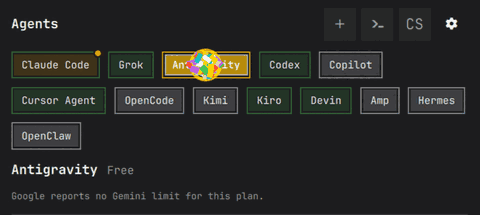
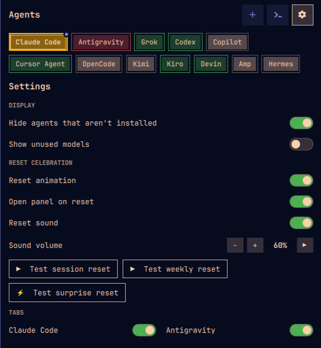

# Cook Meter

**Know exactly when you can go cook.** (Plugin id and repo: `spaceman.agent-usage-tabs`.)

> **The idea:** a dashboard for developers in flow state. One glance at the bar shows every
> agent's limits, and a celebration fires the moment a reset lands.

## See it


*A scheduled reset: Claude Code's session meter reset on time, so its chip flashes green with a burst of confetti.*



*A surprise reset: an Antigravity meter dropped before its reset time, so the chip flashes gold with two shockwave rings and a burst of rainbow confetti.*

GIFs have no sound. The real thing plays a short cha-ching for a normal reset (and a jackpot for a surprise).

Cook Meter is an [Omarchy](https://omarchy.org) bar plugin (its plugin id and repo are still
`spaceman-agent-usage-tabs`, so existing installs and links keep working) that shows how much of your AI coding
agents' usage limits you have used: one bar icon, one panel, and a tab for every agent
you have installed.


The header has the **+** (Omarchy's add-subscription flow), **>_** (start your default agent) and gear buttons; the
tabs sit below it, then the selected agent's limits and models, and a **LAUNCH** row at the bottom: **Claude Squad** as the main button and a smaller **App** beside it.

## Quick start (new to Omarchy?)

Omarchy is a Linux desktop with a bar across the top of the screen. This plugin adds an
icon to that bar. Click it to open the panel above.

**1. Install it - one command, in a terminal:**

```
omarchy plugin add https://github.com/SpacemanProducts/spaceman-agent-usage-tabs.git --enable
```

From a local copy of the repo instead: `omarchy plugin add /path/to/spaceman-agent-usage-tabs --enable`.

**2. Click the robot icon in the bar.** Each tool you have installed gets a tab. Tools you
haven't installed are hidden, and a new one shows up on its own the next time the panel
refreshes (every 5 minutes).

**3. Sign in to the tools you want to see.** A tab for a tool you aren't signed in to says
so in one line. These need a login first:

| Tool | Sign in with |
|---|---|
| Claude Code | `claude` (then `/login`) |
| Antigravity | `agy` |
| Grok | `grok login` |
| Codex | `codex login` |
| Copilot | `copilot login`, and `gh auth login` for the usage numbers |
| Cursor Agent | `agent login` |
| Kimi | `kimi login` |
| Kiro | `kiro-cli login` |
| Devin | `devin auth login` |
| Amp | `amp login` |
| Hermes | optional: sign in to Nous Portal with `hermes model` |

**No login needed:** OpenCode (its free models just work) and Hermes (it shows as free and
local until you sign in).

## What it does

**In the bar**
- A number next to the icon, like the battery: the highest *session* usage across your
  agents. Amber from 60%, red above 85%.

**The tabs**
- One tab per installed agent, with full names, in an order you choose.
- Each tab chip shows two meters at a glance: the **outer border is the session meter** and
  the **inner fill is the weekly meter**. Green under 60%, amber 60-85%, red above 85%, gray
  when there is no data. An agent with one meter uses it for both. The selected tab has a
  thicker border.
- Tabs for agents that aren't installed are hidden; they appear automatically once you
  install the tool, with a one-time notification. You can also hide any installed tab on
  purpose (in the gear settings), and it stays hidden until you turn it back on.
- A **gray** tab has no meter at all, and says why: *Not installed*, *Not signed in*, or *No usage source* (the agent
  doesn't report limits here). A monthly or credit-style meter still colors the chip.
- When a hidden agent signs in for the first time, you get a one-time "now available" notice.

**Inside a tab**
- **Limits:** session, weekly and monthly meters, each with a reset countdown and the exact
  local reset time (`resets in 3d 2h · Tue Nov 24, 3:12 AM`).
- **Models:** every model the agent can use. Models in use come first; unused ones are
  dimmed with a 0; models your plan can't use say *unavailable* (never 0); models with an
  announced removal carry an amber *removing Dec 14* badge. Long lists show 8 rows with a
  "N more models" toggle.
- **Tokens by day:** a collapsible section, closed by default, with today's total always
  visible.
- **Plan and free-tier notes** from what each tool itself reports (see below).
- **One calm status line** instead of an error card when a tool has no data. If a tab can't
  read its data, or the data doesn't look right, it says **"Data looks wrong"** and the
  details go to a log (see *Report a problem*).
- Claude's tab adds a **Fable Weekly** meter only when your account reports one. A **Resets**
  line (banked limit resets) appears only when the agent reports them; see the known gap below.

**Plan notes, per agent** (shown only from what the tool reports)

| Agent | What it shows |
|---|---|
| Copilot | The plan's monthly reset date. A meter appears only for plans with an included allowance. |
| OpenCode | A note that free models have an unpublished daily limit. |
| Kimi | Whichever windows your login reports; nothing without a login. |
| Kiro | A credits meter (used of the monthly total) with its reset date. |
| Amp | A daily allowance, only if Amp reports one. |
| Hermes | "Free and local", or the Nous Portal free-tier note once you're signed in. |

**Alerts and the reset celebration**
- **Each alert fires once per usage window, per agent:** one notification when a session or weekly limit first passes the threshold
  (95% by default, adjustable), one when the limit is hit (100%), and one celebration per reset. What already fired is remembered
  across restarts and forgotten only when that window resets, so a meter that stays high, flickers or briefly fails to load
  never repeats an alert.
- When a session or weekly meter drops by more than 50 points, that's a reset, and you
  get a short celebration: the panel opens on that agent's tab (**without taking keyboard
  focus**), confetti bursts over its chip while the chip flashes green, a short cha-ching
  plays, and a desktop notification with a cash-burst picture says "*Agent* reset. Go cook."
  The panel closes itself after about 5 seconds.
- **Surprise resets (Antigravity):** if an Antigravity meter drops by more than 50 points
  *before its recorded reset time has arrived* (by more than 5 minutes), it was reset early,
  and that gets its own celebration, kept separate from the normal 5-hour and weekly ones: a
  much bigger burst of gold and rainbow confetti with two gold shockwave rings over the chip,
  a longer animation, a gold chip flash, a jackpot sound (a coin cascade under a rising
  fanfare) instead of the cha-ching, and its own notification picture.
  **The wording stays honest.** The plugin can only see your own meters, so by default the
  message says what it knows: "Antigravity just reset early, go cook." Only if
  [agyresets.com](https://agyresets.com/) (a free tracker of the Antigravity team's reset
  announcements; not affiliated with Google) has an announcement from about that time that
  covers your plan and that meter does it say "Google just reset everyone, go cook.", crediting
  the announcer. If the lookup finds nothing or fails, the honest wording stands.
  Agyresets is asked only when a surprise is detected, and nothing about you is sent. A drop
  after the reset time is a normal reset. A surprise is never claimed without a readable
  previous reset time, and other agents never get one (an early drop on them is more likely
  you spending a banked reset yourself).

**The gear icon** in the panel header opens a short settings view (shown below), grouped under three headings:
**Display** (hide uninstalled agents, show unused models), **Reset celebration** (the animation, opening the panel on
reset, the sound and its volume, and **Test session reset**, **Test weekly reset** and **Test surprise reset** buttons
that replay each celebration any time) and **Tabs** (a switch per agent, plus **Reset order**).



**Only plan limits, usage and resets are shown.** Purchasable credit balances, overage,
on-demand spend and top-ups are deliberately never displayed.

### Multiple accounts and the App button

If an agent has more than one signed-in account in Omarchy's own account list (`omarchy agent account`),
its tab lists each account: label, plan, an ACTIVE mark, and its own session and weekly meters. The tab
chip, the bar number and the alerts use the worst meter across the accounts, and a reset celebration
names the account that reset. The plugin only reads Omarchy's usage records through
`omarchy-agent-account-list`; it never reads or stores credentials, and email addresses are dropped.

Under the **LAUNCH** heading at the bottom, the smaller, quieter **App** button (beside the main **Claude Squad** button) starts
the selected agent's own CLI on building a new Omarchy app, the same task the stock panel's App tile gives the default agent:
Claude Code opens `claude`, Antigravity `agy`, Grok `grok`, and so on, in a terminal, started plainly (no
permission-skipping flags) from `~/Work` when that folder exists. An agent with no CLI has no button; Kimi can't take a
starting prompt, so it opens with the prompt on the clipboard. The hover tooltip names the agent.


*Two accounts on Claude Code, with made-up labels and numbers: this machine has one account per provider, so this view is staged.*

### Claude Squad


The **Claude Squad** button (the main button under **LAUNCH**) opens [Claude Squad](https://github.com/smtg-ai/claude-squad) (`cs`) with a
session for each agent you choose, all in **one window**. It first checks that `cs` is installed and offers a one-click
install (it runs the project's install script in a terminal, so you see it). Then tick the agents and press **Run**.

A single terminal opens, always shows a folder picker first (the last repo you used is preselected, so Enter reuses
it), shows which repo it is about to open, takes the repo's name as its title, and starts one `cs` session per ticked
agent. Only this one window ever appears: no helper terminals are opened, and if an extra Squad window shows up it is
closed once the sessions are started. `cs` has no command line for creating sessions, so the plugin types the keys for you
(`n`, a name, Enter, then detach), running `cs -p <agent>` for each so every session keeps its own program, and leaves you
in the session list. It needs `python3`, `tmux` and `git`; without Python it opens `cs` on the first agent only.

A session counts as **started** once the agent's program is running in its tmux session, so an agent waiting on a trust or
login prompt (Codex asking whether to trust the folder, say) is a successful start. The window says `COULD NOT START` only if
the session never came up or its program exited at once. The agents are also written as profiles in
`~/.claude-squad/config.json` (your own profiles and `default_program` are left alone) as a fallback for a `cs` version that
offers a profile picker; `cs` 1.0.20 does not show one.

The folder picker offers your recent git repos (the ones you picked before, plus the repos in `~/Projects`, with backups and
desktop files hidden), then **Create a new project** (a folder in `~/Projects` with git set up and a first commit), then
**Browse...** for anywhere else (a plain folder gets `git init` after you confirm). The window opens tiled, like a normal
terminal.

### Tab order and the default agent

Drag a chip onto another to reorder the tabs; the order is saved and survives restarts. **Reset order** in the gear menu
restores Claude Code, Antigravity, Grok, Codex, then the rest. Agents new to the list go at the end. The **first tab is Omarchy's default agent**: when the first position changes the
plugin sets it, so the shortcut, the right-click on the robot and the header terminal button follow, and a small dot marks
the first chip. Only agents Omarchy supports as a default are used; an unsupported or uninstalled first tab is skipped. It
writes `~/.config/omarchy/defaults/agent` directly rather than running `omarchy default agent`, which would also launch
the agent in a terminal.

### Themes

The panel follows the active Omarchy theme live (switch themes and it changes with no restart): text, background and
borders come from the theme's popup colors and icons from its accent. The green, amber and red meter colors, and the
celebration colors, switch to deeper variants on a light theme so they stay readable. The chrome is kept quiet so the usage bars stand
out: chip borders are soft and thin, the buttons are faint theme-colored tints, and the chips keep their green/amber/red meter
color (the point of a chip) at a lower volume.

## Known gap: banked limit resets can't be read

Some accounts hold banked "limit resets". The usage endpoint the Claude Code login can reach
answers that those resets aren't offered to that kind of client (`eligible: false`, reason
`surface`), so **a Claude Resets line will not appear for the Claude Code login**, even when
the claude.ai web app shows resets for the same account. Codex reports its resets, so its
Resets line shows when it has any. **This plugin never spends or triggers a reset**; there is
no reset button.

## Requirements

- Omarchy with shell plugins (`omarchy plugin` works)
- `node` 18 or newer (it uses built-in `fetch`)
- `notify-send` for notifications, and `pw-play` (PipeWire), `paplay` or `ffplay` for the sound
- `secret-tool` (libsecret), only for Antigravity if its login is in the keyring
- `gh` (GitHub CLI), only for Copilot's usage numbers
- Omarchy's own `omarchy-agent-usage-*` collectors, used for Codex, Cursor, OpenCode, Kimi,
  Devin and Hermes token history

## Install by hand

If you'd rather not use the one-liner:

1. Put the folder at `~/.config/omarchy/plugins/spaceman.agent-usage-tabs/`.
2. `omarchy plugin enable spaceman.agent-usage-tabs`
3. `omarchy-restart-shell` (so the shell compiles the QML; hot reload isn't reliable)
4. Click the robot icon. Middle-click cycles tabs. In the panel: Left/Right switch tabs,
   Space toggles the daily section, `r` refreshes, Esc closes.

## Settings

Everything on the gear is saved to the plugin's own `settings.json` (in
`~/.local/state/omarchy/agent-usage-tabs/`), which takes priority over `shell.json`. These
three are set only in the plugin's entry in `~/.config/omarchy/shell.json`:

```json
{
  "id": "spaceman.agent-usage-tabs",
  "tabOrder": "claude,antigravity,grok,codex",
  "refreshIntervalSec": 300,
  "notifyThreshold": 95
}
```

| Setting | Default | Meaning |
|---|---|---|
| `tabOrder` | all 12, as listed | Comma-separated agent ids, in tab order. Ids you leave out are appended in default order. |
| `refreshIntervalSec` | 300 | How often data refreshes. Minimum 60. |
| `notifyThreshold` | 95 | Notify when a session or weekly limit passes this percent. |

Gear settings, all on by default: `hideUninstalledAgents`, `showUnusedModels`,
`resetAnimation`, `resetSound` (with `resetVolume`, 0-100, default 60), `autoOpenOnReset`,
and `hiddenAgents` (the tabs you hid). They also work as keys in `shell.json`.

Agent ids: `claude`, `antigravity`, `grok`, `codex`, `copilot`, `cursor`, `opencode`,
`kimi`, `kiro`, `devin`, `amp`, `hermes`. Back up `shell.json` before editing it, and restart
the shell after changing a setting there.

## Where the data comes from

`bin/collect.mjs` writes one file, `~/.local/state/omarchy/agent-usage-tabs/data.json`, and the
panel only reads it.

| Agent | Source |
|---|---|
| Claude Code | Anthropic's OAuth usage endpoint with your Claude Code login, plus tokens from your local transcripts (last 7 days). Cached 5 minutes because the endpoint rate-limits. |
| Grok | Grok's billing endpoints, with the Grok CLI login. |
| Antigravity | Google's quota endpoint, with the local `agy` login. |
| Copilot | GitHub's Copilot quota endpoint, with the token `gh auth token` prints. |
| Kiro | `kiro-cli chat --no-interactive "/usage"`. |
| Amp, Hermes | `amp usage` and `hermes status`, for sign-in state and the plan notes above. |
| Codex, Cursor, OpenCode, Kimi, Devin | Omarchy's `omarchy-agent-usage-<agent>` records. |

**Expired logins refresh themselves.** Grok's and Antigravity's tokens last hours. When one has
lapsed, the plugin runs that tool's own `models` command once in the background (headless,
at most once every 10 minutes) so the tool refreshes its own login. The plugin never writes
or refreshes a token itself.

## Models and `models.json`

Each tab's Models list is built live-data-first:

1. models the agent reported using (last 7 days for Claude, all time for the others),
2. models the agent's own CLI says it can use, refreshed every 6 hours (`agy models`,
   `grok models`, `opencode models`, `devin models`, `kiro-cli chat --list-models`,
   `codex debug models`),
3. the entries in **`models.json`**, which you can edit by hand: known models, plan and
   free-tier notes, and announced removals.

If a CLI lists its models, any `models.json` entry missing from that list shows as
*unavailable*. Without a CLI list (Cursor, Copilot, Kimi, Amp, Hermes, Claude), an entry is
unavailable only if you list the plan in its `unavailableOn`. Put `"removing": "2026-12-14"`
(or `"2026-12"`) on a model with an announced removal; a past date shows *past removal date*,
which is how a model looks when it's still listed after its announced removal. Delete a model
that is truly gone. Edits apply on the next refresh, and a malformed file is ignored.

## Privacy and safety

- Logins are read-only. Each token is sent only to its own vendor's endpoint listed above.
- Nothing is sent anywhere else: no telemetry, no analytics. The one exception is the
  agyresets.com lookup above, made only when a surprise Antigravity reset is detected, with
  a plain request that carries nothing about you. Reset announcements come from
  [agyresets.com](https://agyresets.com/); please credit it if you reuse that data.
- Everything the plugin keeps is in `~/.local/state/omarchy/agent-usage-tabs/`.
- The sounds (the cha-ching and the surprise jackpot) and the notification pictures (the
  cash-burst and the surprise lightning-burst) are self-made (see `sounds/make-*.py` and
  `notify/*.svg`) and released to the public domain.

## Report a problem

Something broken or looking wrong? Please open an issue:
**https://github.com/SpacemanProducts/spaceman-agent-usage-tabs/issues**

A tab that couldn't read its data shows "Data looks wrong"; the details are in
`~/.local/state/omarchy/agent-usage-tabs/collector.log`. Please include that and the version
number (shown at the bottom of the gear settings). See [CHANGELOG.md](CHANGELOG.md) for what
changed in each version.

## Troubleshooting

- **Icon missing from the bar:** it hides when no agent is installed. Run
  `node ~/.config/omarchy/plugins/spaceman.agent-usage-tabs/bin/collect.mjs` and check for errors.
- **Changes not showing:** run `omarchy-restart-shell`.
- **QML errors:** `qs log -i <instance>` and look for `agent-usage`.
- **Claude shows "Rate limited":** it is showing the last known limits; wait a few minutes.

## Tests

```
for t in bin/*.test.mjs; do node "$t"; done
```

## Uninstall

```
omarchy plugin disable spaceman.agent-usage-tabs
omarchy plugin remove spaceman.agent-usage-tabs --yes
rm -r ~/.local/state/omarchy/agent-usage-tabs
```

## License

[MIT](LICENSE)
